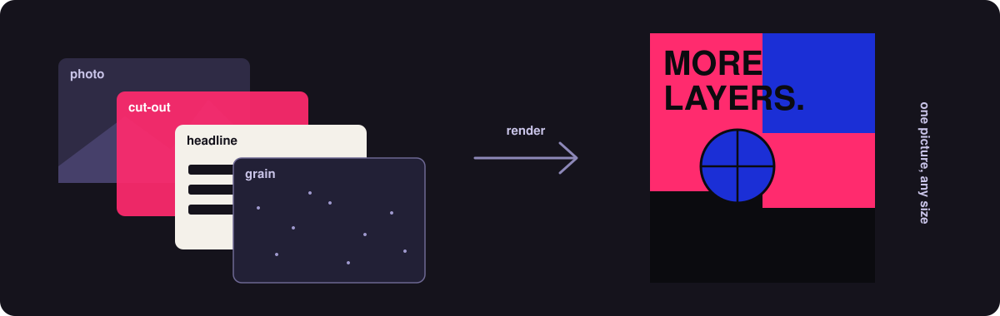

<p align="center">
  
</p>

<h1 align="center">bullterrier-scene</h1>

<p align="center">
  <b>Stack pictures, drawings and type into one finished picture.</b><br>
  Posters, covers, collages and any other layered picture, written as code you can rerun.
</p>

<p align="center">
  
  
  
  
  
</p>

**A layered picture is a stack. Write the stack down once, change a photo or a headline, render it again.**

Take a poster. In a design app it is often a dozen layers: a photo, the same photo cut out around the subject, a huge headline
that sits behind the subject's head but in front of the background, a few flat shapes, film grain over the top. It lives
in one file, and making the next one means opening it and redoing the work by hand.

bullterrier-scene keeps that stack as something you can read, change and run again. Each layer is a picture, a vector
drawing or a block of type. You say where it sits, what it hides, how it blends with the layers under it and which
effects it gets. The scene then draws everything at the size you ask for, from a phone screen to a print.

<table>
  <tr>
    <td width="33%" valign="top"><b>Layers of any kind</b><br>A photo, a photo with a look applied, a drawing or text from <code>bullterrier-vector</code>, a flat colour or a gradient, even another scene.</td>
    <td width="33%" valign="top"><b>Placed, masked, blended</b><br>Move, turn, scale and skew a layer. Hide parts of it with a shape, the letters of a headline or a cut-out of the subject. Blend it like in a design app: multiply, screen, overlay and the rest.</td>
    <td width="33%" valign="top"><b>Effects per layer or per group</b><br>Grain on the whole poster, a halftone on one photo, a glow on the headline. The effects come from <code>bullterrier-image</code>.</td>
  </tr>
  <tr>
    <td width="33%" valign="top"><b>One template, many pictures</b><br>Swap the photo, the title or a colour and render again. A hundred covers from one scene is a loop, not a hundred files.</td>
    <td width="33%" valign="top"><b>Any size, same picture</b><br>Draft small, print large. Every layer is drawn at the final size by the package that owns it, so the draft shows what the print will.</td>
    <td width="33%" valign="top"><b>Big canvases without big memory</b><br>A large picture is drawn a strip at a time, so fifteen layers at print size do not need fifteen full-size pictures in memory at once.</td>
  </tr>
</table>

## What it looks like

A sketch of the idea, not the real interface. The API is designed from examples in the first batch of work
([roadmap](docs/roadmap.md), A1) and will differ.

```python
# illustration only: the names below are not final
poster = Scene(width=1800, height=2400)
poster.add(photo("dancer.jpg").look("two-inks"))  # the background
poster.add(text("MORE LAYERS.", font="display.ttf").behind(subject))  # type tucked behind the dancer
poster.add(photo("dancer.jpg").cut_out())  # the dancer, over the type
poster.add(grain(amount=0.3))  # over everything

poster.render().save("poster.png")
```

Change `dancer.jpg` and the headline, run it again: a second poster, same design. Two more sketches, to show where else the
same idea goes:

```python
# illustration only: one design, many pictures
for episode in episodes:
    card = cover.with_values(title=episode.title, photo=episode.photo)
    card.render(size=(1280, 720)).save(f"{episode.id}.png")

# illustration only: a value you set per frame is an animation
for frame in range(48):
    scene.with_values(slide=frame / 47).render().save(f"frame-{frame:02}.png")
```

## What you can make

Nothing renders yet; this is what the design allows and the [roadmap](docs/roadmap.md) delivers, batch by batch.

- **Stills.** Posters, flyers, tickets and certificates; album, book and podcast covers; social cards, banners and
  thumbnails; collages and photo grids; before-and-after pairs; product mockups (a photo placed on a tilted surface);
  infographics and diagrams that contain photos; a magazine spread or a slide, each page a scene.
- **One design, many pictures.** Swap the photo, the title or a colour and render again: a hundred episode thumbnails,
  personalised cards, a poster per city. This is the idea of `bullterrier-image` (one look on a thousand photos) one level up.
- **Motion.** A scene has no clock of its own; a value in it (a position, a colour, how far a headline has slid in) is a
  number you set before each render. Set it a little differently for every frame and render again, and the frames make an
  animation: kinetic type, an animated cover, a loop, a frame sequence to lay over footage. Drawing only what changed keeps
  that cheap (planned, batch C7), and the video tool is built on exactly this.
- **Generative pieces.** Drawings from `bullterrier-vector` (hatching, flow lines, type) and fields from
  `bullterrier-image` (noise, light) composed with photos in one picture.
- **Large and reusable.** Print-size canvases drawn in strips; a finished badge or logo lockup built once as a scene and used
  inside other scenes. Print colour and PDF come later.

Not for: an editing app or painting tools, 3D, photo retouching, or working with footage (that is video's).

## Rust first, Python on top

The engine is a Rust crate, `bullterrier-scene`, with no Python in it. The Python package is a thin layer over the same crate,
as in the sibling packages, so a Rust program can use scenes without Python and a Python script gets the same results.

## Why it is its own package

`bullterrier-image` changes one picture and `bullterrier-vector` draws shapes and type. Neither can place a photo inside
a letter, or put type between a background and a cut-out, without knowing about the other, and they are built never to
depend on each other. Putting layers together is a job of its own, so it lives here, and the later video tool builds on it:
a video frame is a scene drawn at one moment. The reasoning is in [docs/design.md](docs/design.md).

## Status

**Pre-alpha, and private.** The project is scaffolded and its checks pass, but no scene can be drawn yet: the first
working render is planned for the third batch ([docs/roadmap.md](docs/roadmap.md)). The repository is private because it
is built on two sibling packages that are themselves not released; it opens up when they do.

## Works with

bullterrier-scene is one of six packages in [Bullterrier Studio](https://github.com/bullterrier-studio). Unlike its
siblings it is not stand-alone: it draws its layers with `bullterrier-image` (photos and their effects) and
`bullterrier-vector` (shapes and type), and it can read control signals from `bullterrier-control` to drive a value.
`bullterrier-video` uses it in turn. Ecosystem: [docs/ecosystem.md](docs/ecosystem.md).

## Development

```bash
uv sync && uv run poe setup    # once: environment (builds the Rust core, needs rustup), git hooks
uv run poe check               # every gate, before a merge
```

See [CONTRIBUTING.md](CONTRIBUTING.md). Every rule is in [CLAUDE.md](CLAUDE.md).

## Licence

MIT, see [LICENSE](LICENSE).
