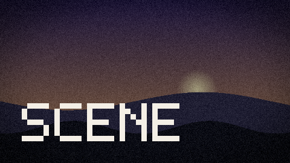

# Gallery

One picture per batch, written by `uv run poe look` from `docs/examples/` (the same call writes the larger
`dist/look/c1.png`). Every photo here is generated in code.

| Picture | Batch | What it shows |
|---|---|---|
|  | C1 | A synthetic dusk photo with one image look (cooler, darker, a vignette, fine grain) and a vector headline drawn over it, rendered whole at 480 pixels by `c1_first_picture.py` |
