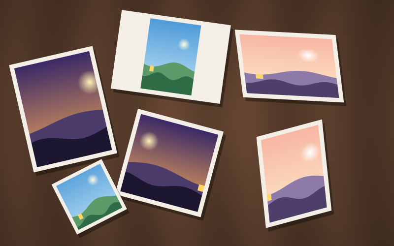
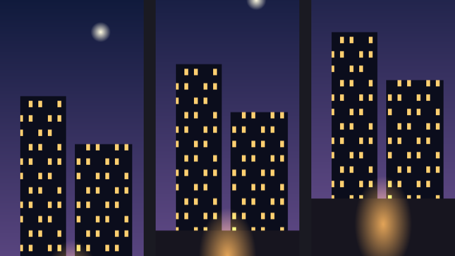
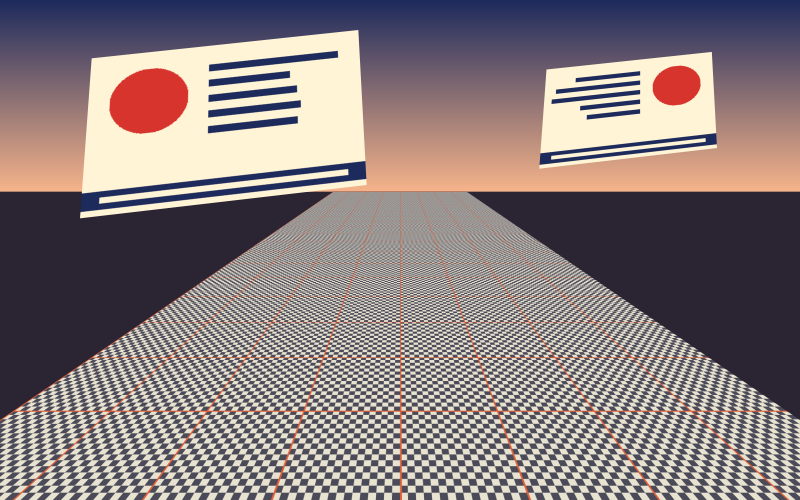
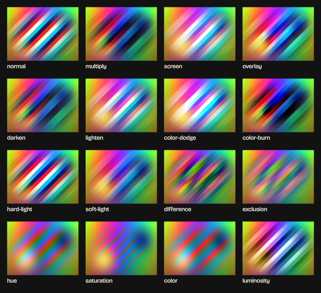

# Gallery

One or two pictures per batch, written by `uv run poe look` from `docs/examples/` (the same call writes the larger ones to
`dist/look/`). Every picture here is generated in code.

| Picture | Batch | What it shows |
|---|---|---|
|  | C1 | A synthetic dusk photo with one image look (cooler, darker, a vignette, fine grain) and a vector headline drawn over it, rendered whole at 480 pixels by `c1_first_picture.py` |
|  | C2 | Six synthetic snapshots on a table, each `fit` into its own frame (a wide photo cut by `cover` into a tall one, a tall photo kept whole by `contain` with paper either side, a square squashed by `stretch`) and then turned, skewed, mirrored or scaled about its frame by `place`; each has a paper margin and a shadow that is the same placement moved. `c2_prints.py`, 800 pixels |
|  | C2 | The delivery crop: one 900 by 2000 photo `fit` with `cover` into a 720 by 1280 frame three times, `align` 0, 0.5 and 1 on the long side, so the top, the middle or the bottom stays and the rest is cut at the frame's edge. `c2_prints.py`, 760 pixels |
|  | C2b | A checker road receding to a horizon (a trapezoid a tenth as wide at the far end, checks of 8 pixels in a picture that is mostly many checks to a pixel there) under a gradient sky, and two billboards in perspective, one on a general quadrilateral and one on the same corners mirrored: the poster seen from behind. The road keeps its checks near and fades to grey far away; `c2b_perspective.py`, 800 pixels |
|  | C3 | A synthetic landscape that shows only inside the letters of CLIP (a mask by a text layer), the line BEHIND passing behind a cut-out figure (a mask by the figure's own matte, inverted, on the type), a warm glow and a contact shadow on the floor and a vignette (masks with a feather). `c3_clip.py`, 800 pixels |
|  | C4a | A contact sheet of the sixteen W3C blend modes by their CSS names, each tile the same hue-swept backdrop with the same striped source (opaque in the middle, clear at the edge) laid over it by one mode and labelled by a text layer: multiply darkens and screen lightens, color-dodge and color-burn blow out and crush, difference and exclusion go muted, and hue, saturation, color and luminosity keep the backdrop's brightness or colour and take the rest from the stripes. `c4a_blends.py`, 660 pixels |
